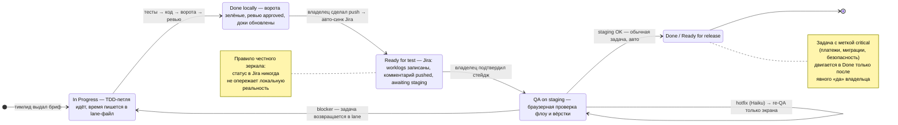

# Полный цикл AI-Dev Framework

От сырой идеи владельца до закрытой задачи в Jira: кто что делает, на какой модели, через какие ворота проходит работа и куда стекается память. Файлы-первоисточники каждого этапа — в `framework/process/`.

## Шесть фаз одним взглядом

Фаза 0**Discovery**

Идея → видение. PO исследует, скептик атакует, владелец утверждает. Без ворот владельца архитектуры не бывает.

Фаза 0.5**Дизайн**

Картинка → design-tokens.json → Figma-шаблоны строго в своём проекте. Код берёт токены, Figma — зеркало.

Фаза 1**Планирование**

Контракты заморожены, тимлид режет lanes с непересекающимися файлами и задачи ≤2 ч под дешёвые модели.

Фаза 2**Исполнение**

TDD-петля в каждой lane параллельно: красные тесты → код → ворота → ревью. Время пишется в lane-файл.

Фаза 3–4**Интеграция и QA**

Один интегратор, union тестов после каждого мерджа; затем ручной QA в реальном браузере и дешёвый hotfix-контур.

Фаза 5**Закрытие**

Отчёт, строка в HISTORY, retro в knowledge/, STATE.md перезаписан — следующая сессия стартует без потерь.

## Диаграмма 1 — весь цикл: роли, действия, ворота

действие роли ворота — решение, блокирующее переход участие владельца (человека)

```mermaid
flowchart TD
  subgraph F0["Фаза 0 · Discovery"]
    O1(("Владелец: сырая идея"))
    O1 --> R1["Оркестратор · Fable: intake-раунды — до 4 вопросов, каждый с вариантами и рекомендацией"]
    R1 -->|2–3 раунда черновиков| O1
    R1 --> PO1["PO · Opus: конкуренты и рынок — каждое утверждение с URL-источником или меткой unverified"]
    PO1 --> FM["PO: карта фич — table-stakes / улучшить / дифференциатор + lean canvas и варианты монетизации"]
    FM --> SK["Скептик · Fable: кто платит? почему конкуренты этого не сделали? какая гипотеза убьёт проект первой?"]
    SK -->|правки| PO1
    SK --> AS["Недоказанное → assumptions.md: риск + самый дешёвый эксперимент проверки"]
    AS --> G0{"ВОРОТА ВЛАДЕЛЬЦА: vision + границы MVP + монетизация утверждены → ADR"}
    G0 -->|нет| R1
  end

  G0 -->|да| HD["BA · Opus → spec.md с проверяемыми критериями · PM → backlog + Jira"]
  HD --> DS["Дизайнер · Fable: картинка владельца → design-tokens.json + design-spec.md → Figma-шаблоны только в своём проекте"]

  subgraph F1["Фаза 1 · Планирование спринта"]
    DS --> AR["Архитектор · Fable: архитектура, ADR, контракты C-NNN заморожены до старта параллельной работы"]
    AR --> TL["Тимлид · Opus: lanes с непересекающимися файлами, ≤3 штук · задачи ≤2 ч: критерии, список файлов, out-of-scope, grep-ключи errors.md"]
    TL --> G1{"Проверка архитектора: lanes изолированы, зависимости только через замороженные контракты?"}
    G1 -->|нет — переплан| TL
  end

  subgraph F2["Фаза 2 · Исполнение: TDD-петля в каждой lane параллельно"]
    G1 -->|да| TE["test-engineer · Haiku: красные тесты из критериев — stub-proof, RED подтверждён"]
    TE --> DV["developer · Haiku: минимальный чистый код до зелёного — тесты только своей lane"]
    DV --> G2{"Ворота: typecheck + lint + тесты lane — хуки гоняют автоматически"}
    G2 -->|красные · 2 фейла = эскалация Haiku→Sonnet→стоп| DV
    G2 -->|зелёные| RV["code-reviewer · Haiku: stub-check, check-lane по диффу, docs-sync, адверсариальные инпуты"]
    RV -->|fix-list| DV
    RV -->|approved| LR["Lane-отчёт: что сделано, время по ролям, ошибки-кандидаты в память"]
  end

  subgraph F3["Фаза 3 · Интеграция"]
    LR --> IN["Интегратор · Fable — единственный, кто мерджит: миграции → контракты → фичи; Mode B — git worktrees на команду"]
    IN --> G3{"Union всех тестов зелёный после каждого мерджа?"}
    G3 -->|нет — возврат в lane с фейлом| DV
  end

  subgraph F4["Фаза 4 · Стейдж, QA и Jira"]
    G3 -->|да| PU(("Владелец пушит в git"))
    PU --> JSY["Авто-синк Jira: worklogs по ролям + комментарий pushed, awaiting staging + статус Ready for test"]
    JSY --> G4{"Владелец подтвердил: стейдж развёрнут, можно проверять?"}
    G4 -->|да| QA["qa-engineer · Opus: реальный браузер — флоу целиком + визуал 1440×900 и 375×812, каждая находка со скриншотом и репро"]
    QA --> G5{"Находки?"}
    G5 -->|blocker — спринт не закрывается| DV
    G5 -->|major / minor / visual| HF["/hotfix: Haiku-дев на батч находок, ворота остаются зелёными, re-QA только починенных экранов"]
    HF --> QA
    G5 -->|чисто| JOK{"Jira: staging OK → продвижение статуса. Critical-задача?"}
    JOK -->|нет — авто в Done| RP
    JOK -->|да: платежи, миграции, безопасность| OW(("Владелец: явное да"))
    OW --> RP
  end

  subgraph F5["Фаза 5 · Закрытие и память"]
    RP["Отчёт спринта на языке владельца + блок в HISTORY.md"]
    RP --> RT["/retro: ошибки → errors.md · паттерны → patterns.md · системные сбои процесса → правки плейбуков"]
    RT --> ST["STATE.md перезаписан: фаза, in-flight, waiting-on, следующие 3 шага"]
  end

  ST -.->|уроки входят в брифы следующего спринта| TL
```

Каждый ромб — ворота: пока условие не выполнено, работа не движется дальше. Круги — три точки, где обязателен человек: утверждение видения, push и подтверждение стейджа, «да» для критичных задач. Пунктир внизу — контур памяти: retro меняет брифы и плейбуки следующего спринта.

## Диаграмма 2 — жизненный цикл одной задачи (локально ↔ Jira)

Источник истины — локальные файлы задач; Jira — зеркало для людей, синхронизируемое в фиксированные моменты (push, подтверждение стейджа, вердикт QA), а не непрерывно.

## Команда: кто, на какой модели, что владеет и что запрещено

| Роль | Модель | Владеет | Запрещено |
| --- | --- | --- | --- |
| Оркестратор | Fable 5 | процесс, общение с владельцем, брифы, STATE.md | писать код; читать исходники — только планы и отчёты |
| PO | Opus 5.5 | vision, конкуренты, карта фич, монетизация | обещать доход; выдумывать рыночные цифры; открытые анкеты |
| Скептик | Fable 5 | адверсариальный проход по discovery | одобрять без списка рисков; смягчать; чинить самому |
| BA | Opus 5.5 | spec.md, domain-model, глоссарий | выдумывать требования, не подтверждённые владельцем |
| PM | Opus 5.5 | backlog, приоритеты, зеркало в Jira | менять технические решения |
| Архитектор | Fable 5 | architecture.md, ADR, заморозка контрактов | реализовывать; менять замороженный контракт без ADR |
| Тимлид | Opus 5.5 | план спринта, декомпозиция ≤2 ч | выдавать задачу без проверяемых критериев и списка файлов |
| Дизайнер | Fable 5 | design-tokens.json, design-spec, Figma-шаблоны | чужие Figma-проекты; значения мимо токенов |
| test-engineer | Haiku 5.5 | красные тесты из критериев | писать продакшн-код; тесты, проходимые заглушкой |
| developer | Haiku 5.5 | код, делающий тесты зелёными | файлы вне своей lane; ослаблять тесты; молча буксовать |
| code-reviewer | Haiku 5.5 | вердикт по lane: ворота, stub-check, изоляция | штамповать approve, не прогнав проверки самому |
| Интегратор | Fable 5 | мерджи, union тестов, worktrees | решать конфликт выбрасыванием чьих-то тестов; мерджить параллельно |
| qa-engineer | Opus 5.5 | qa-report: флоу + визуал на двух вьюпортах | чинить код; находка без скриншота и репро |

## Три контура, которые держат систему

**Эскалация**

Haiku фейлит дважды → один раз чинится бриф (чаще всего баг именно там) → Sonnet с историей фейлов → стоп и разбор у архитектора. Никакого бесконечного «гринда».

**Память**

errors.md — ошибка оплачивается один раз (агенты грепают его до дебага); patterns.md — что копировать; HISTORY.md — хроника спринтов; retro превращает повторяющиеся сбои в правки плейбуков.

**Контекст**

Сессия читает CLAUDE.md + STATE.md и больше ничего без нужды; оркестратор живёт на отчётах ≤30 строк; всё долговечное — в файлах, чат одноразовый.